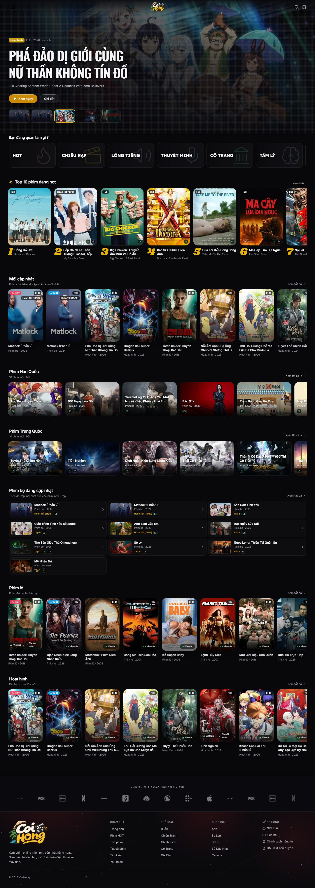
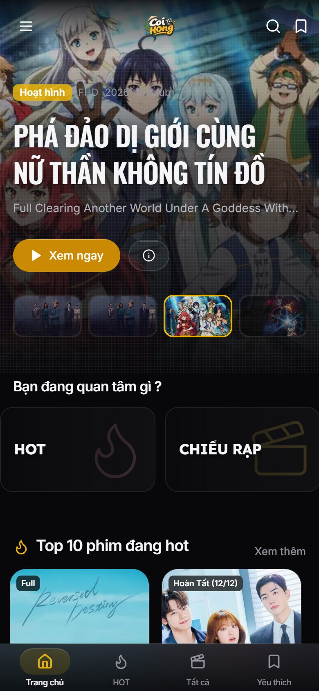
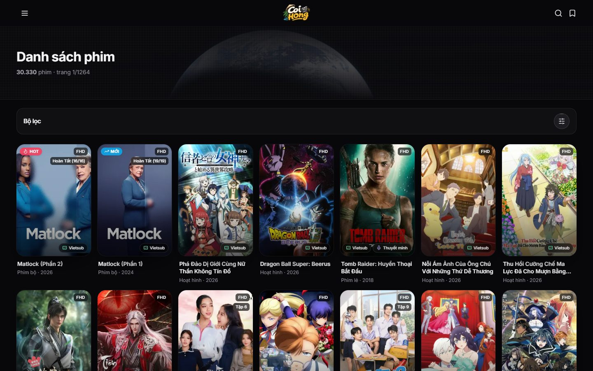
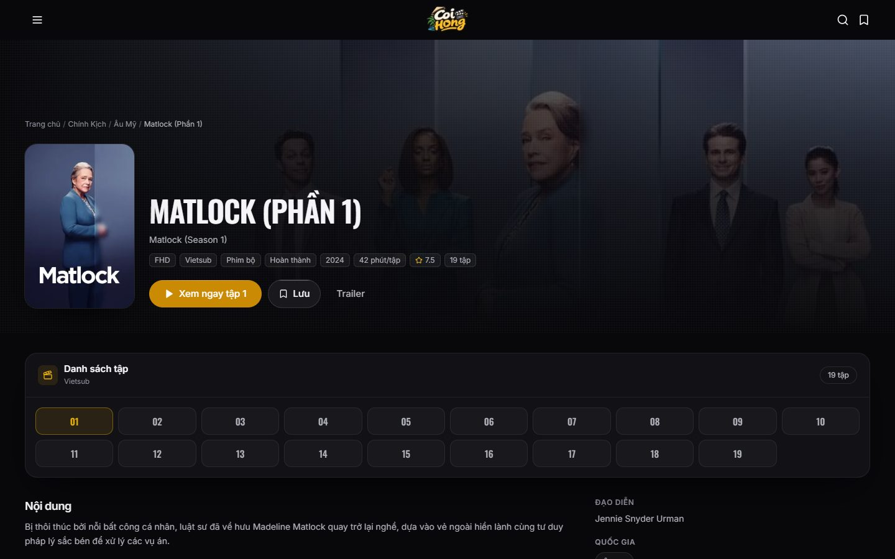
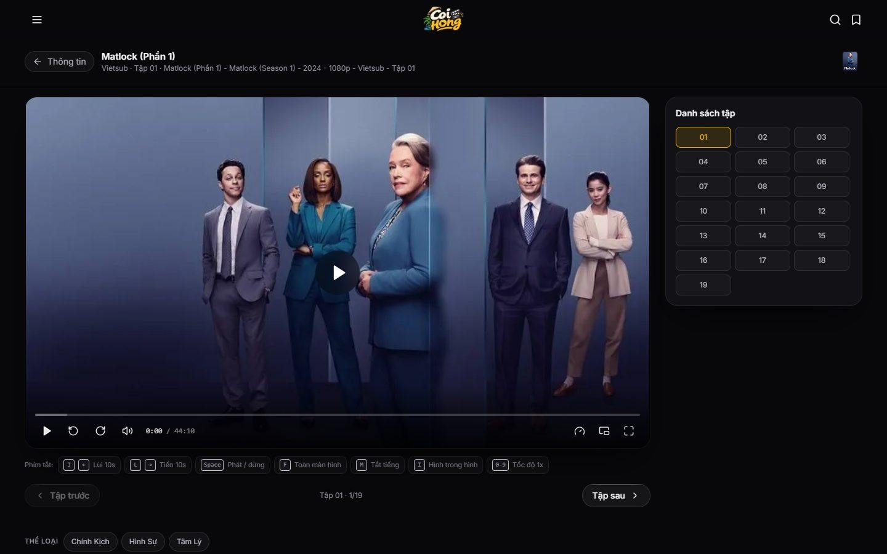
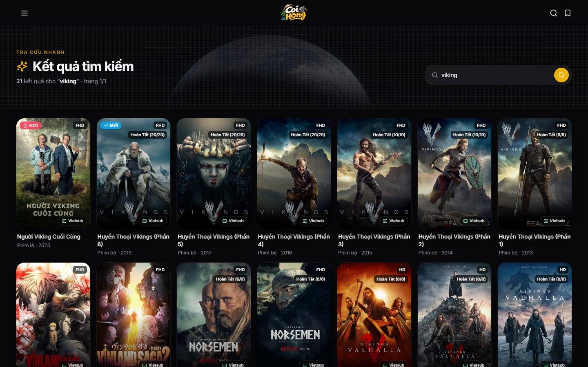
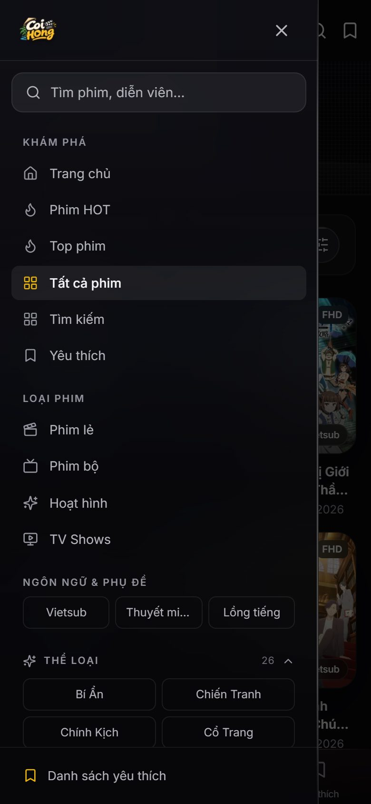

<div align="center">


# CoiHong

**A fast, dark-themed movie streaming catalog built on Next.js 15.**  
Uses the public KKPhim / PhimAPI — no backend, no API key, no sign-up.

[](#)
[](#)
[](#)
[](#)
[](#)
[](LICENSE)

**English** · [Tiếng Việt](README.vi.md)

</div>

---

## Screenshots

<p align="center">
  
</p>

<p align="center">
  
  &nbsp;
  
  &nbsp;
  
</p>

<p align="center">
  
  &nbsp;
  
  &nbsp;
  
</p>

---

## Overview

CoiHong is a frontend-only streaming browser. Every page is server-rendered with the Next.js App Router and cached with ISR, so repeat visits are fast and the upstream API is not hammered. The video player pulls the stream directly from the provider's CDN to the viewer's browser — no video bytes pass through the CoiHong server.

- **No domain lock-in:** runs on an IP, `localhost`, or any hostname. `sitemap.xml` and `robots.txt` always reflect the host that is actually serving the request.
- **No accounts:** favorites and watch progress are stored in the browser (`localStorage` and a `ch_progress` cookie).

---

## Routes

| Page | Path |
|:--|:--|
| Home: hero banner, Top 10, movie rows by genre and country | `/` |
| Trending now: sorted by rating and recency | `/hot` |
| Top movies ranking: sorted by recently added | `/top-phim` |
| Movie listing with filters and pagination | `/danh-sach`, `/danh-sach/:type` |
| By genre / country / year | `/the-loai/:slug`, `/quoc-gia/:slug`, `/nam/:year` |
| Genre and country index pages | `/the-loai`, `/quoc-gia` |
| Search | `/tim-kiem?q=` |
| Movie detail | `/phim/:slug` |
| Watch: player and episode list | `/xem-phim/:slug` |
| Watchlist (browser-local) | `/quan-tainh` |
| About / Contact / Privacy / DMCA | `/gioi-thieu`, `/lien-he`, `/chinh-sach-rieng-tu`, `/dmca` |

`/phim/:slug/xem` permanently redirects to `/phim/:slug`.

---

## Features

**Automatic player**

- Seek with progress bar, volume, speed 0.5–2×, picture-in-picture, fullscreen
- Auto-switch between HLS and Embed sources
- Keyboard shortcuts:

  | Key | Action |
  |:--|:--|
  | `J` / `←` | Back 10 s |
  | `L` / `→` | Forward 10 s |
  | `Space` | Play / pause |
  | `F` | Fullscreen |
  | `M` | Mute |
  | `I` | Picture-in-picture |
  | `0`–`9` | Jump to 0 %–90 % of the video |

**Watch progress** is remembered in the `ch_progress` cookie (90 days, 24 most recent movies).

**Polish and performance**

- Responsive dark UI with Tailwind, custom fonts, splash screen and custom loading state
- `next/image` with WebP output and a one-year immutable cache for static assets
- ISR on every data page; static pages render on the server

---

## Tech Stack

| Layer | Used |
|:--|:--|
| Framework | Next.js 15 (App Router, standalone output) |
| UI | React 19, TypeScript 5, Tailwind CSS 3, lucide-react |
| Video | `hls.js` 1.x |
| Data | Public KKPhim / PhimAPI (`https://phimapi.com`), no key |
| Testing / tooling | `puppeteer-core` driving real Chromium (Edge) |
| Deployment | Node 22, Docker (multi-stage Alpine), systemd + nginx, or Vercel |

---

## Repository Layout

```text
.
├── client/                 # The Next.js app
│   ├── src/app/            # App Router pages, sitemap.ts, robots.ts
│   ├── src/components/     # Layout, Navbar, Sidebar, Player, Hero, grids...
│   ├── src/lib/            # api.ts (server-only + ISR), site.ts, images.ts,
│   │                       # labels.ts, catalog.ts, progress.ts
│   ├── src/types.ts
│   ├── public/             # Logo sizes, icons, studio logos, OG image
│   ├── deploy/             # systemd unit, nginx vhost, env file, start.sh
│   └── scripts/            # standalone prepare/start helpers
├── docs/
│   ├── API.md              # Full KKPhim / PhimAPI reference
│   └── screenshots/        # Documentation screenshots
├── scripts/                # Logo build, deploy packaging, Chromium checks
├── Dockerfile              # Multi-stage build (node:22-alpine)
├── docker-compose.yml
└── package.json            # Root scripts that delegate into client/
```

---

## Requirements

- **Node.js 20.9+** (Node 22 recommended — the Docker image uses 22)
- **npm 10+**
- Optional: **Docker** with Compose v2 for containerized deployment
- Optional: **Microsoft Edge** or Chrome if you want to run the screenshot / visual check scripts

---

## Getting Started

All commands are run from the repository root. They delegate into `client/`.

```bash
git clone https://github.com/Namtran592005/CoiHong.git
cd CoiHong

npm run setup     # install dependencies into client/
npm run dev       # http://localhost:3000
```

Production build:

```bash
npm run build     # next build + prepare standalone output
npm run start     # http://localhost:4173
```

Type check:

```bash
npm run typecheck
```

> The project does not require an API key. It calls `https://phimapi.com` directly. If you hit rate limits, self-host a compatible KKPhim instance and point `API_BASE` at it.

---

## Configuration

Copy `client/.env.example` to `client/.env` if you need to override defaults.

| Variable | Default | Meaning |
|:--|:--|:--|
| `API_BASE` | `https://phimapi.com` | Upstream API base URL. **Server-side only** — never exposed to the browser. |
| `NEXT_PUBLIC_SITE_URL` | *(empty)* | Optional. Origin used for `og:image` and canonical URLs. Leave blank to derive it from each request. |
| `PORT` | `3000` | Port for the standalone server. |

The project is **not pinned to any domain**. Leave `NEXT_PUBLIC_SITE_URL` empty and deploy anywhere — the sitemap and robots files will always return the correct host.

---

## Data and Caching

All API calls go through `client/src/lib/api.ts`, which is marked `server-only` and uses ISR:

| Data | Revalidate |
|:--|:--|
| Home page | 5 minutes |
| Listings | 3 minutes |
| Movie detail | 1 hour |
| People data | 24 hours |
| Genres / countries catalog | 24 hours |

A 15-second `AbortController` timeout wraps every upstream request. Upstream errors are mapped to a typed `ApiError` and rendered by the App Router `error.tsx` boundary.

Full endpoint reference (parameters, response shape, CDN host): [`docs/API.md`](docs/API.md).

**Only the player talks to the outside world from the viewer's machine.** HLS playlists (`m3u8`) and embed iframes load directly from the provider's server to the viewer's browser — video bandwidth never crosses the CoiHong server.

---

## Deployment

### Docker

```bash
docker build -t coihong .
docker run -d -p 3000:3000 --name coihong coihong
```

Or with Compose (reads `API_BASE` / `NEXT_PUBLIC_SITE_URL` from the environment):

```bash
docker compose up -d --build
```

The image is a three-stage build: `deps` → `builder` → `runner`, runs as the non-root `node` user, and ships a health check that fetches `/robots.txt`.

### VPS (standalone, no `npm` on the server)

The production build runs in Next.js `standalone` mode, so the server only needs **Node 18+** — no `npm install`.

```bash
npm run build
npm run pack      # bundles everything into dist/coihong
```

The bundle includes:

- `client/server.js` (the standalone server)
- A systemd unit (`coihong.service`)
- An nginx vhost (`nginx-coihong.conf`)
- An env file (`coihong.env`)
- `README-deploy.md` with step-by-step instructions

> Behind a reverse proxy, forward `Host`, `X-Forwarded-Proto` and `X-Forwarded-Host` so canonical URLs and the sitemap stay correct. The bundled nginx config already does this.

### Vercel

Set **Root Directory** to `client` and use the **Next.js** framework preset. Leave `NEXT_PUBLIC_SITE_URL` empty unless you need absolute URLs.

---

## Testing and Visual Checks

The `scripts/` folder contains real-browser checks using `puppeteer-core` + Edge. Start a production server first:

```bash
npm run build && npm run start   # server on :4173

npm run check:responsive         # horizontal overflow at many viewport sizes
npm run check:cache              # watch-progress cookie behaviour
npm run check:marquee            # studio logo marquee
npm run shot:docs                # regenerate docs/screenshots
```

The remaining checks (404 pages, hydration warnings, image loading, contrast, console cleanliness, blur cost, banner brightness, poster speed, icon edges, grain, failed requests) live in `scripts/` as `check-*.mjs`. Run any of them directly with `node scripts/<name>.mjs`.

---

## License

The source code is released under the [MIT License](LICENSE).

This license **covers the project's source code only**. Movie data and stream URLs come from third-party providers and remain the property of their respective rights holders — they are not covered by MIT. CoiHong only builds the interface.

For content takedown requests or feedback: [@Namtran592005](https://github.com/Namtran592005), or see the `/dmca` page.
