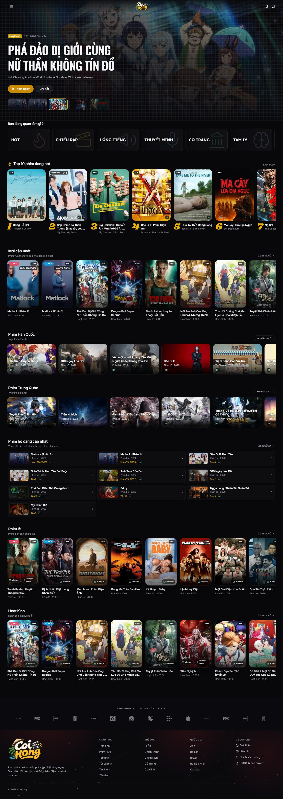
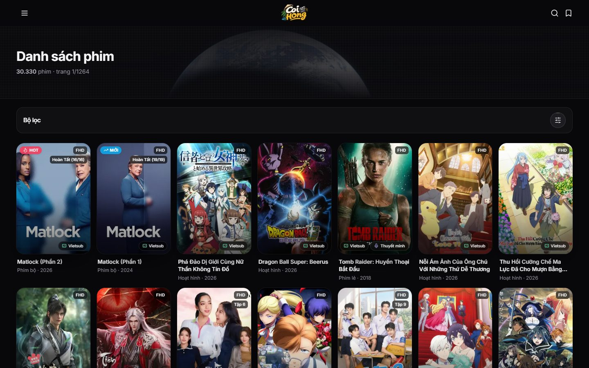
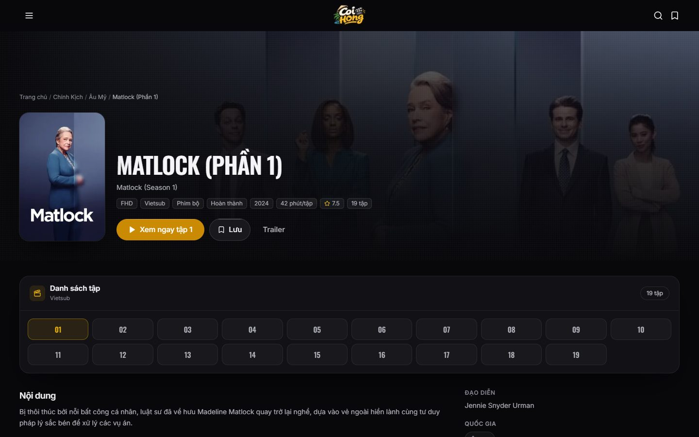
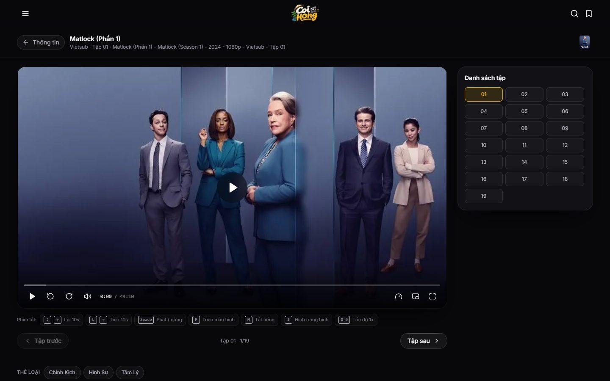
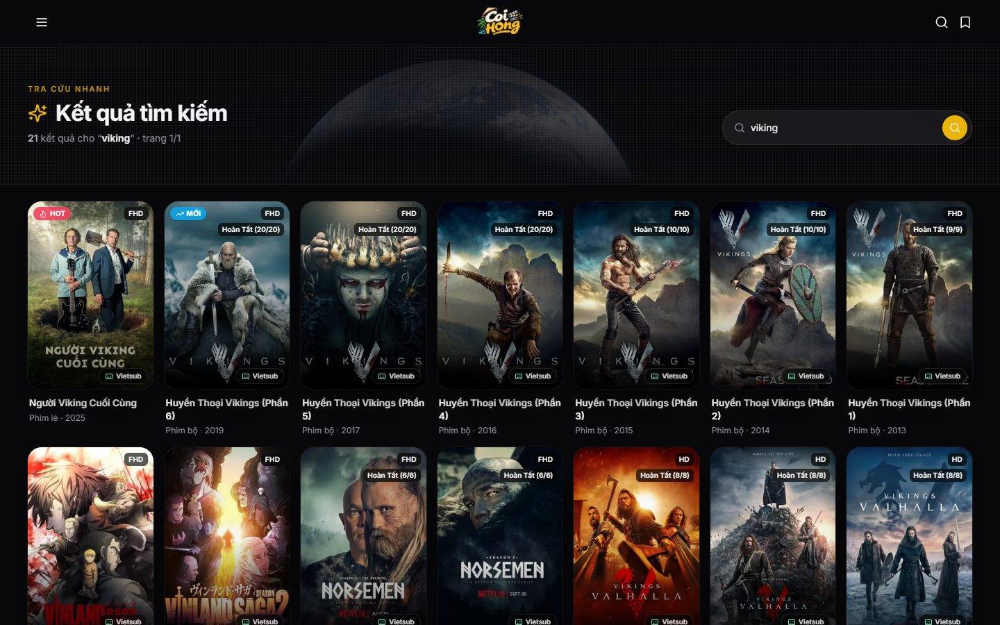
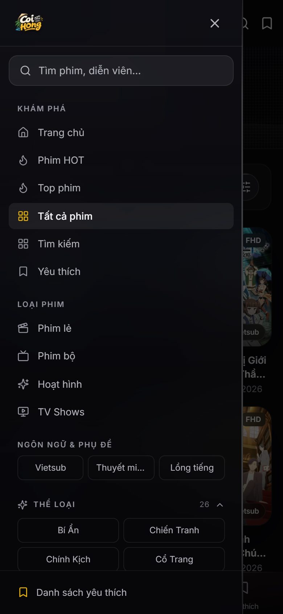

<div align="center">


# CoiHong

**Web xem phim giao diện tối, tốc độ cao, xây dựng bằng Next.js 15.**  
Dùng API công khai KKPhim / PhimAPI — không cần backend, không cần API key, không cần đăng nhập.

[](#)
[](#)
[](#)
[](#)
[](#)
[](LICENSE)

[English](README.md) · **Tiếng Việt**

</div>

---

## Ảnh chụp

<p align="center">
  
</p>

<p align="center">
  
  &nbsp;
  
  &nbsp;
  
</p>

<p align="center">
  
  &nbsp;
  
  &nbsp;
  
</p>

---

## Giới thiệu

CoiHong là một trình duyệt danh mục phim chạy hoàn toàn ở tầng giao diện. Mọi trang được render phía server bằng Next.js App Router và cache bằng ISR, nên lần truy cập sau rất nhanh mà không gây tải lên API nguồn. Player lấy luồng phát trực tiếp từ CDN của nhà cung cấp tới trình duyệt người xem — không có byte video nào đi qua máy chủ CoiHong.

- **Không gắn với domain nào:** chạy bằng IP, `localhost` hay tên miền bất kỳ đều được. `sitemap.xml` và `robots.txt` luôn trả đúng về nơi đang phục vụ.
- **Không cần tài khoản:** danh sách yêu thích và tiến trình xem lưu ngay trong trình duyệt (`localStorage` và cookie `ch_progress`).

---

## Các trang

| Trang | Đường dẫn |
|:--|:--|
| Trang chủ: banner, Top 10, các nhóm phim theo thể loại và quốc gia | `/` |
| Phim đang nóng: xếp theo điểm đánh giá và độ cập nhật | `/hot` |
| Bảng xếp hạng Top phim: xếp theo thứ tự thêm mới | `/top-phim` |
| Danh sách phim, lọc và phân trang | `/danh-sach`, `/danh-sach/:type` |
| Theo thể loại / quốc gia / năm | `/the-loai/:slug`, `/quoc-gia/:slug`, `/nam/:year` |
| Trang mục lục thể loại và quốc gia | `/the-loai`, `/quoc-gia` |
| Tìm kiếm | `/tim-kiem?q=` |
| Thông tin phim | `/phim/:slug` |
| Xem phim: player và danh sách tập | `/xem-phim/:slug` |
| Yêu thích (lưu cục bộ trong trình duyệt) | `/quan-tainh` |
| Giới thiệu / Liên hệ / Chính sách riêng tư / DMCA | `/gioi-thieu`, `/lien-he`, `/chinh-sach-rieng-tu`, `/dmca` |

`/phim/:slug/xem` chuyển hướng vĩnh viễn về `/phim/:slug`.

---

## Tính năng

**Player tự động**

- Tua có vùng đã tải, âm lượng, tốc độ 0.5–2×, hình trong hình, toàn màn hình
- Tự chuyển giữa nguồn HLS và Embed
- Phím tắt:

  | Phím | Chức năng |
  |:--|:--|
  | `J` / `←` | Lùi 10 giây |
  | `L` / `→` | Tiến 10 giây |
  | `Space` | Phát / dừng |
  | `F` | Toàn màn hình |
  | `M` | Tắt tiếng |
  | `I` | Hình trong hình |
  | `0`–`9` | Nhảy tới 0 %–90 % thời lượng |

**Nhớ tiến trình xem** bằng cookie `ch_progress` (90 ngày, 24 phim gần nhất).

**Giao diện và hiệu năng**

- Giao diện tối, responsive bằng Tailwind, font tùy chỉnh, splash screen và trạng thái loading riêng
- `next/image` xuất WebP, tài nguyên tĩnh cache `immutable` một năm
- ISR cho mọi trang dữ liệu; các trang tĩnh render phía server

---

## Công nghệ

| Thành phần | Sử dụng |
|:--|:--|
| Framework | Next.js 15 (App Router, output standalone) |
| Giao diện | React 19, TypeScript 5, Tailwind CSS 3, lucide-react |
| Video | `hls.js` 1.x |
| Dữ liệu | KKPhim / PhimAPI công khai (`https://phimapi.com`), không cần key |
| Kiểm thử / công cụ | `puppeteer-core` điều khiển Chromium thật (Edge) |
| Triển khai | Node 22, Docker (multi-stage Alpine), systemd + nginx, hoặc Vercel |

---

## Cấu trúc repo

```text
.
├── client/                 # Ứng dụng Next.js
│   ├── src/app/            # Các trang App Router, sitemap.ts, robots.ts
│   ├── src/components/     # Layout, Navbar, Sidebar, Player, Hero, các grid...
│   ├── src/lib/            # api.ts (server-only + ISR), site.ts, images.ts,
│   │                       # labels.ts, catalog.ts, progress.ts
│   ├── src/types.ts
│   ├── public/             # Logo nhiều kích cỡ, icon, logo hãng phim, ảnh OG
│   ├── deploy/             # systemd unit, nginx vhost, file env, start.sh
│   └── scripts/            # Script chuẩn bị / khởi động standalone
├── docs/
│   ├── API.md              # Tài liệu đầy đủ KKPhim / PhimAPI
│   └── screenshots/        # Ảnh chụp cho tài liệu
├── scripts/                # Build logo, đóng gói deploy, kiểm thử bằng Chromium
├── Dockerfile              # Build multi-stage (node:22-alpine)
├── docker-compose.yml
└── package.json            # Script gốc chuyển tiếp vào client/
```

---

## Yêu cầu

- **Node.js 20.9+** (khuyến nghị Node 22 — image Docker dùng 22)
- **npm 10+**
- Tuỳ chọn: **Docker** với Compose v2 nếu muốn chạy bằng container
- Tuỳ chọn: **Microsoft Edge** hoặc Chrome nếu muốn chạy script chụp ảnh / kiểm tra giao diện

---

## Chạy dự án

Mọi lệnh chạy ở thư mục gốc và tự chuyển tiếp vào `client/`.

```bash
git clone https://github.com/Namtran592005/CoiHong.git
cd CoiHong

npm run setup     # cài dependencies vào client/
npm run dev       # http://localhost:3000
```

Build production:

```bash
npm run build     # next build + chuẩn bị output standalone
npm run start     # http://localhost:4173
```

Kiểm tra kiểu:

```bash
npm run typecheck
```

> Dự án không cần API key. Nó gọi thẳng `https://phimapi.com`. Nếu bị giới hạn tốc độ, tự dựng một instance KKPhim tương thích rồi trỏ `API_BASE` vào đó.

---

## Cấu hình

Sao `client/.env.example` thành `client/.env` nếu cần ghi đè giá trị mặc định.

| Biến | Mặc định | Ý nghĩa |
|:--|:--|:--|
| `API_BASE` | `https://phimapi.com` | Base URL của API nguồn. **Chỉ dùng ở server** — không bao giờ lộ ra trình duyệt. |
| `NEXT_PUBLIC_SITE_URL` | *(trống)* | Tuỳ chọn. Gốc dùng cho `og:image` và URL canonical. Để trống thì tự suy ra từ mỗi request. |
| `PORT` | `3000` | Cổng cho server standalone. |

Dự án **không ghim domain nào**. Để trống `NEXT_PUBLIC_SITE_URL` và triển khai ở đâu cũng được — sitemap và robots luôn trả đúng host.

---

## Dữ liệu và cache

Mọi lệnh gọi API đều đi qua `client/src/lib/api.ts`, file này đánh dấu `server-only` và dùng ISR:

| Dữ liệu | Thời gian revalidate |
|:--|:--|
| Trang chủ | 5 phút |
| Danh sách | 3 phút |
| Chi tiết phim | 1 giờ |
| Dữ liệu diễn viên | 24 giờ |
| Danh mục thể loại / quốc gia | 24 giờ |

Mỗi request nguồn có `AbortController` timeout 15 giây. Lỗi từ API được ánh xạ thành `ApiError` có kiểu và render qua boundary `error.tsx` của App Router.

Tài liệu endpoint đầy đủ (tham số, cấu trúc response, host CDN): [`docs/API.md`](docs/API.md).

**Chỉ player gọi ra ngoài từ máy người dùng.** Playlist HLS (`m3u8`) và iframe embed tải trực tiếp từ server của nhà cung cấp tới trình duyệt người xem — băng thông video không đi qua máy chủ CoiHong.

---

## Triển khai

### Docker

```bash
docker build -t coihong .
docker run -d -p 3000:3000 --name coihong coihong
```

Hoặc bằng Compose (đọc `API_BASE` / `NEXT_PUBLIC_SITE_URL` từ biến môi trường):

```bash
docker compose up -d --build
```

Image build ba tầng `deps` → `builder` → `runner`, chạy bằng user `node` không phải root, kèm health check gọi `/robots.txt`.

### VPS (standalone, máy chủ không cần `npm`)

Bản build production chạy ở chế độ `standalone` của Next.js, nên máy chủ chỉ cần **Node 18+** — không cần `npm install`.

```bash
npm run build
npm run pack      # gom toàn bộ vào dist/coihong
```

Gói kèm:

- `client/server.js` (server standalone)
- systemd unit (`coihong.service`)
- nginx vhost (`nginx-coihong.conf`)
- File env (`coihong.env`)
- `README-deploy.md` hướng dẫn từng bước

> Nếu chạy sau reverse proxy, cần chuyển tiếp `Host`, `X-Forwarded-Proto` và `X-Forwarded-Host` để canonical URL và sitemap đúng. Cấu hình nginx đi kèm đã làm sẵn.

### Vercel

Đặt **Root Directory** là `client`, framework preset **Next.js**. Để trống `NEXT_PUBLIC_SITE_URL` trừ khi cần URL tuyệt đối.

---

## Kiểm thử và kiểm tra giao diện

Thư mục `scripts/` chứa các script kiểm thử bằng trình duyệt thật qua `puppeteer-core` + Edge. Cần chạy production server trước:

```bash
npm run build && npm run start   # server ở cổng 4173

npm run check:responsive         # tràn ngang ở nhiều kích thước màn hình
npm run check:cache              # hành vi cookie tiến trình
npm run check:marquee            # dải logo hãng phim
npm run shot:docs                # chụp lại docs/screenshots
```

Các kiểm tra còn lại (trang 404, cảnh báo hydration, tải ảnh, độ tương phản, console sạch, chi phí blur, độ sáng banner, tốc độ poster, viền icon, hạt nhiễu, request lỗi) nằm trong `scripts/` dưới dạng `check-*.mjs`. Chạy trực tiếp bằng `node scripts/<tên>.mjs`.

---

## Giấy phép và bản quyền

Mã nguồn dùng giấy phép [MIT](LICENSE).

Giấy phép này **chỉ phủ mã nguồn của dự án**. Dữ liệu phim và URL phát đến từ máy chủ của nhà cung cấp bên thứ ba và thuộc quyền sở hữu của chủ sở hữu tác phẩm — không nằm trong phạm vi MIT. CoiHong chỉ xây dựng giao diện.

Khiếu nại gỡ nội dung hoặc góp ý: [@Namtran592005](https://github.com/Namtran592005), hoặc xem trang `/dmca`.
